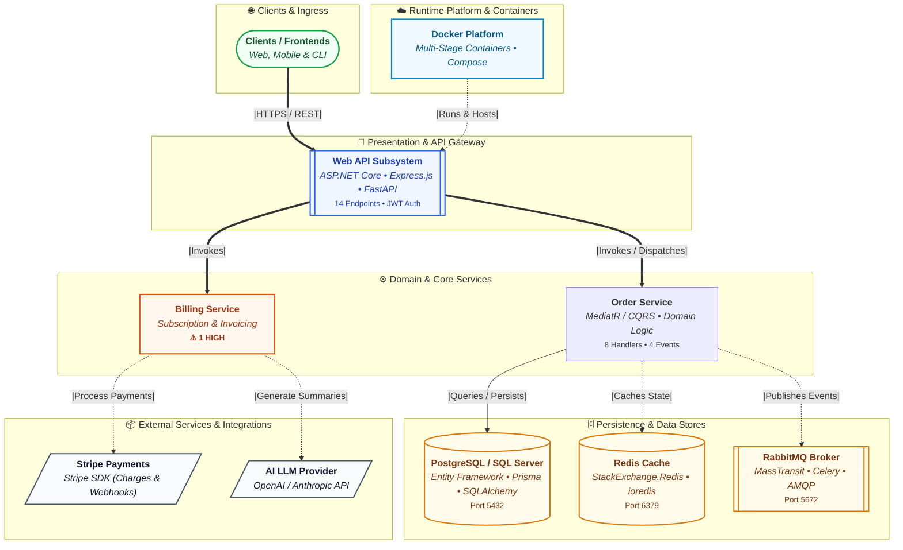

# 🏛️ Architecture Diagrams & Image Rendering Guide

`secdiagram` automatically discovers repository structure and compiles both grounded component graphs and executive-ready C4 system overview diagrams.

---

## 1. High-Level C4 System Diagrams (`secdiagram.com` style)

When explaining system design to engineers, architects, managers, or stakeholders, raw function call graphs create noise. `secdiagram` automatically compiles a clean **C4 Container / Tier System Overview Diagram** into:
- `diagram-highlevel.mmd` (Mermaid code)
- `diagram-highlevel.png` / `.svg` (Rendered image when `--image` is specified)
- Embedded at the top of `ARCHITECTURE.md`

### Visual Architecture Tiering



---

## 2. Detail Level Modes (`--diagram-detail`)

1. **`high-level` (or `--high-level`)**:
   Produces the clean, executive-ready C4 system diagram (`secdiagram.com` style) showing Subsystems, Ingress, Gateways, Core Services, Databases, Caches, Brokers, and External APIs.
2. **`architecture` (default for `diagram.mmd`)**:
   Grounded functional architecture with classes, routes, models, and external dependencies. Class methods are collapsed into parent classes and intra-feature import noise is suppressed.
3. **`full`**:
   Exhaustive raw symbol graph including individual helper functions, private methods, and modules.

```bash
# Generate high-level overview as the primary diagram:
secdiagram --dir . --high-level --image

# Generate detailed architecture flowchart:
secdiagram --dir . --diagram-detail architecture --image
```

---

## 3. Multi-Format Image Generation

Render publication-ready architecture diagrams in **PNG**, **SVG**, or **PDF**:

```bash
# Default PNG output (diagram.png and diagram-highlevel.png):
secdiagram --image

# Crisp vector SVG output:
secdiagram --image svg

# High-resolution PDF document:
secdiagram --image pdf

# Export all diagram formats simultaneously:
secdiagram --format json,md,mermaid,png,svg,pdf
```

### Rendering Providers (`--image-provider`)

1. **`auto` (default)**: Uses local offline Mermaid CLI (`mmdc`) if available. Otherwise, falls back seamlessly to open-source Kroki or mermaid.ink HTTP endpoints via standard library `urllib` (zero pip packages required).
2. **`local`**: Offline rendering via bundled Mermaid CLI (`mmdc`) + headless Chromium.
3. **`kroki`**: Uses public `https://kroki.io` or your private on-premise Kroki container (`--image-endpoint`).
4. **`mermaid.ink`**: Uses the public mermaid.ink image service.

```bash
# Enforce 100% offline rendering (errors if local mmdc is unavailable):
secdiagram --image png --offline

# Use custom on-premise Kroki gateway:
secdiagram --image png --image-provider kroki --image-endpoint http://kroki.internal:8000
```
